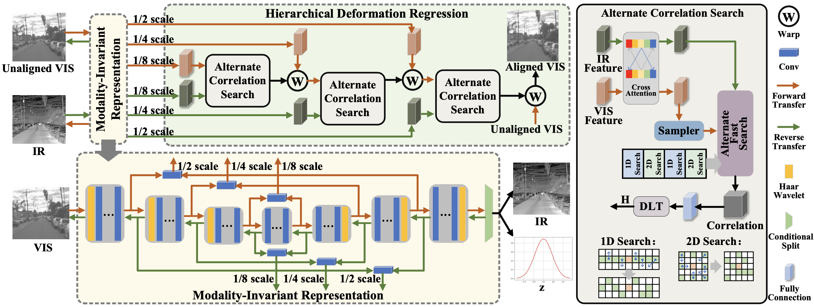

# HR4IR
This is an implement of the HR4IR,
**“Harmonized Domain Enabled Alternate Search for Infrared and Visible Image Alignment"**, 
Zhiying Jiang, Zengxi Zhang, Jinyuan Liu*, *TIP 2025*.

## Overview


## Download
Download the pre-trained model and dataset, and put them in checkpoints/ and benchmarks/
- [Google Drive](https://drive.google.com/drive/folders/1L-1kOCA_fPUpa7o46KjDog4QLccq3CtP?usp=sharing
)
## Quick Test

```
python test.py
```

## Citation
If you find our work useful in your research, please cite our paper:
```
@article{jiang2025harmonized,
  title={Harmonized domain enabled alternate search for infrared and visible image alignment},
  author={Jiang, Zhiying and Zhang, Zengxi and Liu, Jinyuan},
  journal={IEEE Transactions on Image Processing},
  year={2025},
  publisher={IEEE}
}
```